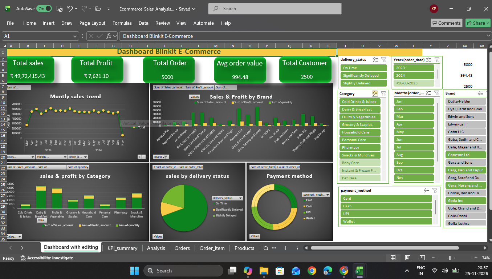

# E-Commerce Sales Analysis | Microsoft Excel

## Project Overview

This project demonstrates an end-to-end e-commerce data analysis using Microsoft Excel. It focuses on transforming raw transactional data into meaningful business insights through data validation, KPI calculations, Pivot Tables, and an interactive dashboard.

## Business Objectives

- Analyze overall sales and profitability.
- Identify high-performing product categories and brands.
- Track monthly sales trends.
- Evaluate customer purchasing patterns.
- Analyze delivery performance and payment methods.
- Present business insights through an interactive dashboard.

## Dataset Overview

| Dataset | Records |
|---|---:|
| Orders | 5,000 |
| Order Items | 5,000 |
| Customers | 2,500 |
| Products | 268 |

## Tools & Skills Used

- Microsoft Excel
- Advanced Excel Formulas
- Data Cleaning and Validation
- Data Lookup Functions
- Pivot Tables
- Data Visualization
- KPI Reporting
- Dashboard Development
- Business Data Analysis

## Key Performance Indicators

Based on the workbook's KPI Summary:

| KPI | Value |
|---|---:|
| Total Sales | ₹49,72,415.43 |
| Total Profit | ₹7,621.10 |
| Total Orders | 5,000 |
| Total Customers | 2,500 |
| Average Order Value | ₹994.48 |
| Overall Profit Margin | 0.15% |

## Analysis Performed

- Category-wise sales and profit analysis
- Brand performance analysis
- Monthly sales trend analysis
- Delivery status analysis
- Payment method performance
- Product pricing and profit margin analysis

## Key Business Insights

- 69.4% of orders were delivered on time.
- 30.6% of orders experienced delivery delays.
- Card payments recorded the highest order count among the available payment methods.
- Delivery efficiency and profitability are potential areas for business improvement.

## Dashboard Features
## Dashboard Preview

- Business KPI summary
- Sales and profit visualization
- Category and brand performance
- Monthly sales trends
- Interactive data reporting

## Business Recommendations

- Investigate the factors affecting overall profitability.
- Improve delivery efficiency to enhance customer satisfaction.
- Monitor product-level margins and pricing.
- Use sales trends to support inventory planning.

## Project Outcome

This project demonstrates my ability to work with multiple datasets, perform business analysis, calculate performance indicators, and create professional Excel dashboards that support data-driven decision-making.

## Author

**Kratika Patidar**

Aspiring Data Analyst | Excel | Power BI | SQL | Python

Open to data analytics projects, internships, and freelance opportunities.

## Disclaimer

This project is created for educational and portfolio purposes and is not an official Blinkit business report.
